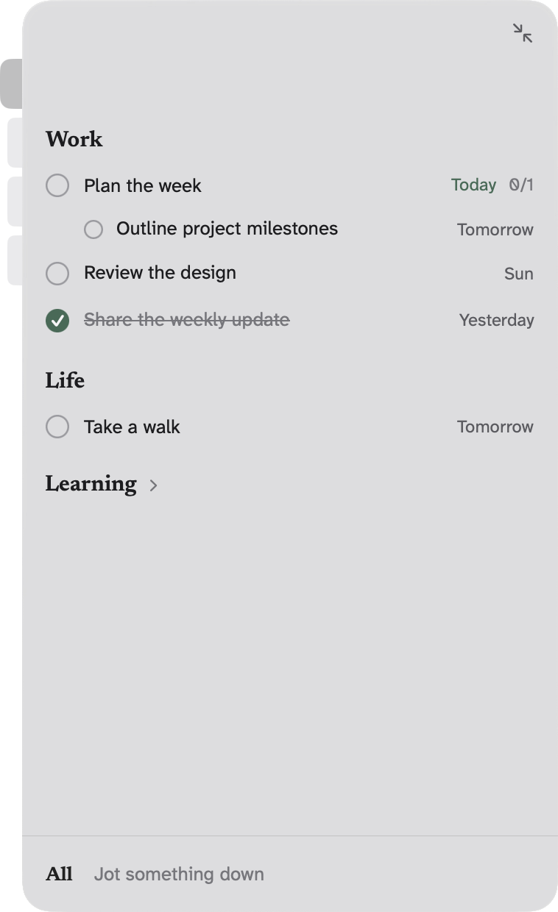
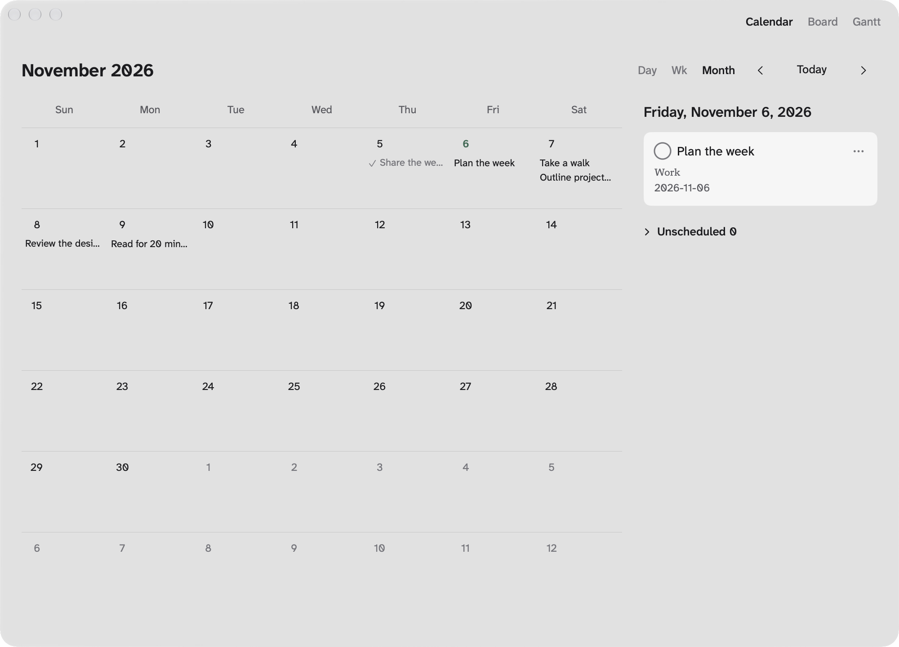

# Dotist

<p align="right"><strong>English</strong> · <a href="README.zh-CN.md">简体中文</a></p>

**A native, local-first task window for macOS.** Dotist stays within reach as a lightweight floating panel, stores tasks in a local SQLite database, and exposes the same task service to the native UI and an optional local MCP interface.

<p align="center">
  
</p>

<p align="center"><sub>The floating task panel keeps groups, dates, and quick entry together (fictional English sample data).</sub></p>

## Why Dotist

- **Native interface**: Built with SwiftUI and AppKit exclusively for Apple Silicon Macs running macOS 26+. Liquid Glass surfaces, keyboard-first navigation, and accessible motion controls.
- **Floating panel & compact bubble**: Keep your task list on your screen edge, or collapse it into a minimal floating bubble that reveals the next task on hover.
- **Hierarchical organization**: Up to 5 levels of nested tasks, multi-select, drag-and-drop reordering, and side group tabs.
- **Multiple perspectives**: Switch smoothly across List, Calendar, Board, and Gantt task views.
- **Local-first SQLite storage**: Tasks and preferences live on your Mac. No account sign-ups, and no cloud lock-in.
- **Optional local MCP interface**: Off by default, with no bundled AI models. Connect local AI tools directly through a stdio proxy.

<p align="center">
  
</p>

<p align="center"><sub>Task views provide Calendar, Board, and Gantt layouts for scheduled work (fictional English sample data).</sub></p>

## Quick Start

- **Add tasks**: Type in the bottom input bar and press `Return`. Press `Return` again to keep adding sibling tasks. Use `Tab` to indent, `Shift-Tab` to outdent, or `Esc` to cancel.
- **Edit & complete**: Click any task title to edit it inline. Press `Space` or `⌘Return` to complete a task.
- **Organize**: Drag tasks or subtrees to reorder. Use `Shift`-click or `⌘`-click for multi-selection. Switch between categories using the left-hand group tabs. Undo and redo anytime with `⌘Z` and `Shift-⌘Z`.
- **Search & focus**: Press `⌘K` to open the command search palette. Click the toolbar collapse button to switch the panel to a floating bubble.
- **Settings**: Press `⌘,` to configure appearance, custom fonts, materials, and MCP settings.

## Installation & Code Signing

1. Download the latest build from [GitHub Releases](https://github.com/Naastek/Dotist/releases/latest).
2. Move `Dotist.app` into `/Applications`.
3. Launch Dotist. The panel will open near the top-right corner of your screen.

> **Requirements**: macOS 26 or later on an Apple Silicon Mac (M-series).

### Gatekeeper & Security

- **Ad-hoc signing**: Current packaging scripts produce ad-hoc signed bundles without Developer ID signing or notarization.
- **First launch**: If macOS Gatekeeper blocks execution on first launch, open **System Settings > Privacy & Security** and choose **Open Anyway**.
- **Sparkle updates**: Application update archives are signed independently with Sparkle cryptographic keys, separate from Apple code signing. Automatic update checks are enabled by default; automatic installation is off.

> **Note**: The latest release on GitHub might not reflect the most recent commit on `main`. Local candidate build scripts do not automatically produce an uploaded release.

## Data, Privacy, and MCP

### Local Storage & Privacy

Dotist requires no user accounts or online registration. Application data is stored locally on your machine:
- **Tasks database**: `~/Library/Application Support/com.dotist.app/tasks.sqlite`
- **Preferences**: `~/Library/Application Support/com.dotist.app/settings.json`

- **Sync**: There is no iCloud, CloudKit, or Android synchronization.

Update checks contact GitHub.

### Optional Local MCP (Model Context Protocol)

Dotist provides a local MCP interface that is **disabled by default** and includes **no bundled AI models**. When enabled in **Settings > MCP**, external MCP clients can connect directly to the application executable via stdio:

```bash
/Applications/Dotist.app/Contents/MacOS/dotist --mcp
```

- **Focus & sessions**: Standard task read and write calls operate silently without stealing window focus; only `focus_task` brings the app forward. Each client runs an isolated MCP session against the shared SQLite database.
- **Network disclosure**: While Dotist itself operates locally without user accounts, connected MCP clients can read and modify tasks and may transmit data to their own upstream AI providers. Using MCP is therefore not a zero-network guarantee.

## Development

Dotist is built with SwiftUI, AppKit, GRDB/SQLite, and the official Swift MCP SDK. It does not use Rust, Tauri, or web runtimes.

### Prerequisites

- Apple Silicon Mac running macOS 26 or later
- Xcode with macOS 26 SDK
- Swift
- Python 3

### Build Commands

```bash
# Run Swift core, MCP, and window test suites
bash native/scripts/test-native.sh

# Build isolated QA app
bash native/scripts/build-qa.sh

# Build local release candidate (does not publish a release)
bash native/scripts/build-local.sh
```

## Documentation

- [UI decisions](docs/ui-decisions.md): Interaction guidelines and visual contracts.
- [Native macOS app](docs/native-macos.md): Data layers, window architecture, QA, signing, and updates.
- [Native consolidation](docs/native-consolidation.md): Technical architecture, Swift task service, and MCP contracts.
