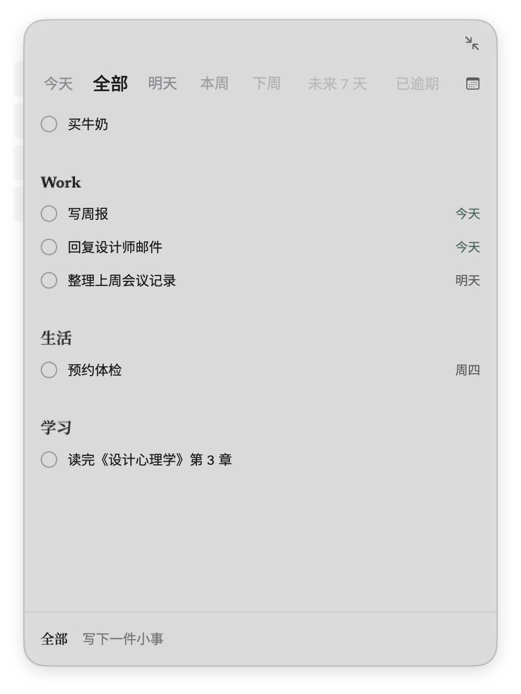
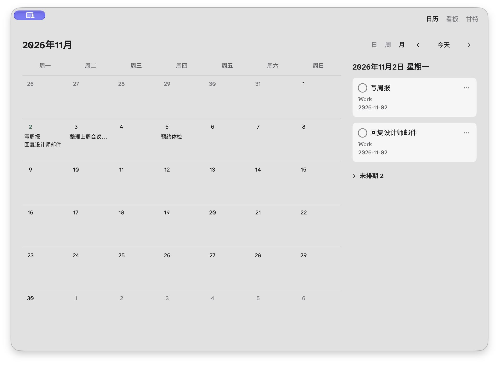

# Dotist

<p align="right"><a href="README.md">English</a> · <strong>简体中文</strong></p>

**Mac 桌面上的本地优先待办小窗。** Dotist 以轻量浮窗常驻桌面边缘，任务保存在本机 SQLite，界面与本地 MCP 客户端共用同一套任务服务。

<p align="center">
  
</p>

<p align="center"><sub>主面板把分组、日期和快速录入放在一起，不需要占满桌面。</sub></p>

## 为什么用 Dotist

大多数任务工具默认需要完整窗口和云端账号，Dotist 选择更轻的路径：

- **本地优先。** 任务和设置都留在 Mac 上，任务使用 SQLite，设置保存在本机文件。
- **随手可达。** 可以使用悬浮面板、菜单栏入口，或悬停后展开的悬浮球。
- **键盘友好。** 添加、缩进、多选、移动、完成和撤销都可以不用鼠标。
- **一套任务服务。** SwiftUI 界面和内置 MCP 服务通过同一个 Swift 任务核心读写数据。

## 功能

- 最多五层任务、多选、拖动排序和撤销/重做。
- 今天、明天、本周、下周、未来 7 天、已逾期、无日期、已完成和自定义日期范围。
- 分组便签、独立分组面板、分组主题色和可折叠分组。
- 收起后显示剩余任务数的悬浮球，悬停可查看下一件任务。
- 按 `⌘K` 打开命令面板。
- 日历、看板和甘特任务视图。
- 原生 macOS 外观、Liquid Glass、可配置字体，以及减少动态效果等无障碍处理。
- 可选的本地 MCP 访问，默认关闭。

<p align="center">
  
</p>

<p align="center"><sub>日历、看板和甘特与悬浮面板共用同一批任务和日期。</sub></p>

## 安装

1. 从 [GitHub Releases](https://github.com/Naastek/Dotist/releases/latest) 下载最新版。
2. 把 `Dotist.app` 移入「应用程序」或其他本地目录。
3. 启动 Dotist。面板默认出现在屏幕右上方。

要求：**macOS 26 或更高版本**，**Apple Silicon Mac**。当前不发布 Intel 包。

当前应用使用 ad hoc 签名，尚未经过 Apple 公证。如果 macOS 阻止首次启动，请打开 **系统设置 → 隐私与安全性**，选择 **仍要打开**。

## 使用

### 添加与编辑任务

- 在底部输入栏输入内容，按 `Return` 添加任务。
- 再按 `Return` 可连续添加同级任务。
- 按 `Tab` 缩进，按 `Shift-Tab` 提升，按 `Esc` 取消。
- 按 `Space` 或 `⌘Return` 完成任务。
- 点击任务标题即可编辑。

### 整理任务

- 用左侧分组便签切换分组。
- 拖动任务或整棵子树调整顺序和层级。
- 按住 `Shift` 或 `⌘` 点击可多选。
- 右键分组可以打开独立面板、修改颜色等。
- 使用 `⌘Z` 和 `Shift-⌘Z` 撤销和重做。

### 查找与聚焦

- 按 `⌘K` 打开命令面板。
- 使用日期筛选缩小任务列表。
- 点击工具栏的收起按钮，把面板变成悬浮球。
- 打开「任务视图」查看日历、看板和甘特。
- 按 `⌘,` 或从菜单栏打开设置。

## 本地 MCP

Dotist 内置可选的本地 MCP 服务，默认关闭，不包含 AI 模型。

在 **设置 → MCP** 中启用后，复制生成的命令或 JSON 配置到 MCP 客户端。客户端以 stdio 代理模式启动应用可执行文件：

```sh
~/Applications/Dotist.app/Contents/MacOS/dotist --mcp
```

代理连接应用内的本机 Unix socket 服务。普通读写不会抢键盘焦点，只有 `focus_task` 会把应用带到前台。每个客户端拥有独立 MCP 会话，同时共享同一任务数据库和变更通知。

可用工具包括 `list_tasks`、`get_task`、`search_tasks`、`add_tasks`、`update_task`、`delete_task`、`restore_task`、日期与父任务操作、分组操作和 `focus_task`。

## 数据与隐私

- 任务保存在 `~/Library/Application Support/com.dotist.app/tasks.sqlite`。
- 偏好设置保存在数据库同目录的 `settings.json`。
- Dotist 不要求账号，也不把任务发送到云服务。
- Android 与 iCloud/CloudKit 同步尚未实现。SQLite 中的本地变更元数据只是为后续工作预留，不代表同步已经可用。

## 开发

当前 macOS 应用使用 SwiftUI、AppKit、GRDB/SQLite 和官方 Swift MCP SDK 构建，不链接 Rust、Tauri 或网页运行时。

要求：macOS 26 或更高版本、Apple Silicon Mac、支持 macOS 26 或更新 SDK 的 Xcode、Swift 与 Python 3。

```sh
bash native/scripts/test-native.sh   # Swift 核心、MCP 和窗口测试
bash native/scripts/build-qa.sh      # 隔离 QA 应用
bash native/scripts/build-local.sh   # 本地发布候选包
```

SwiftPM 依赖由 `native/Package.resolved` 锁定。版本、最低 macOS 版本和公开更新配置集中在 `native/app.json`。

## 更新与发布

Dotist 使用 Sparkle、GitHub Releases 和原生 `appcast.xml` 更新。自动检查默认开启，自动安装默认关闭。下载完成后会在应用正常退出时安装，并在下次启动生效。

推送到 `main` 会运行原生测试、构建应用、创建完整草稿、下载并验证发布资产、检查当前 `main` SHA，然后发布。CI 私钥必须匹配 `native/app.json` 中的公开 Sparkle 密钥。

当前应用包使用 ad hoc 签名。Apple Developer ID 签名与公证和 Sparkle 更新信任链相互独立，目前尚未完成。

## 文档

- [UI 决定](docs/ui-decisions.md)：当前交互与视觉约定。
- [macOS 原生应用](docs/native-macos.md)：数据、窗口、构建、验收、签名与更新。
- [原生技术链路](docs/native-consolidation.md)：Swift 任务服务、MCP 与发布架构。
