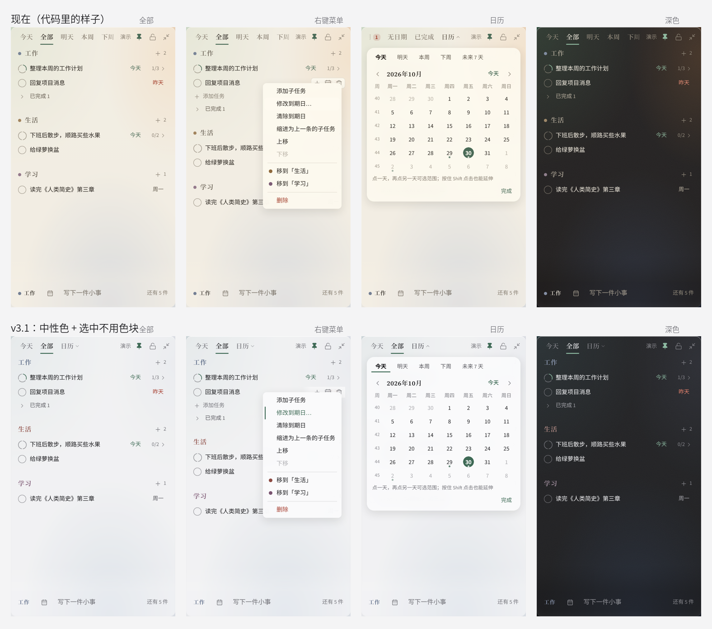
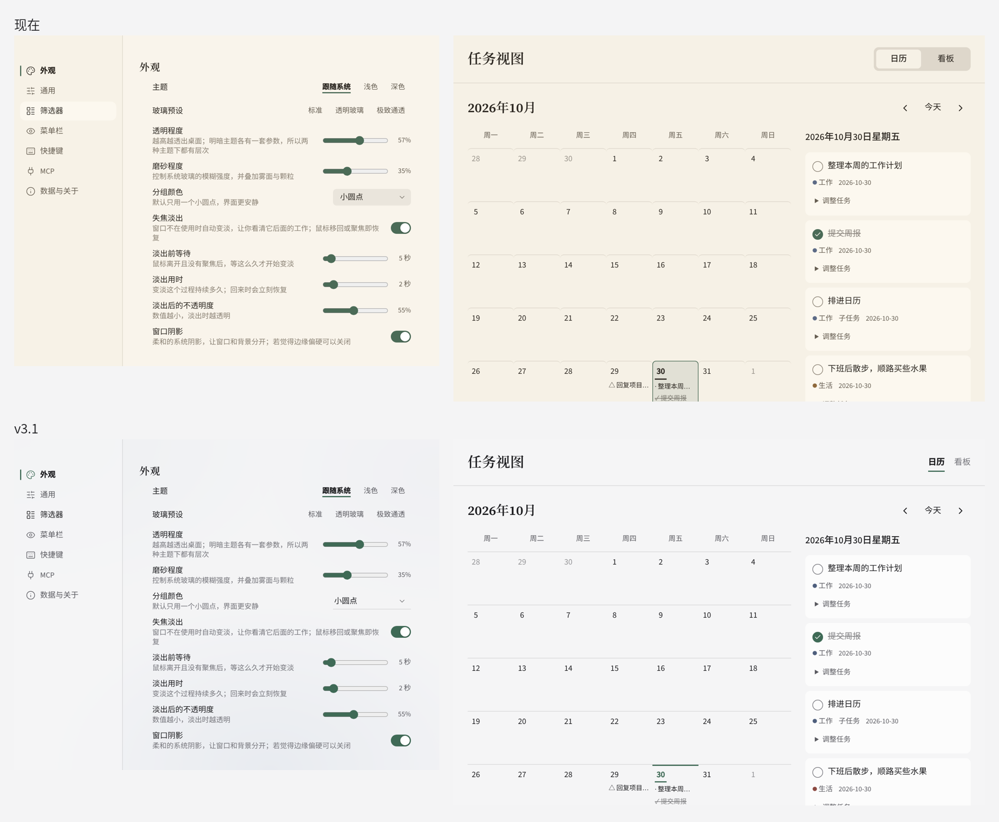
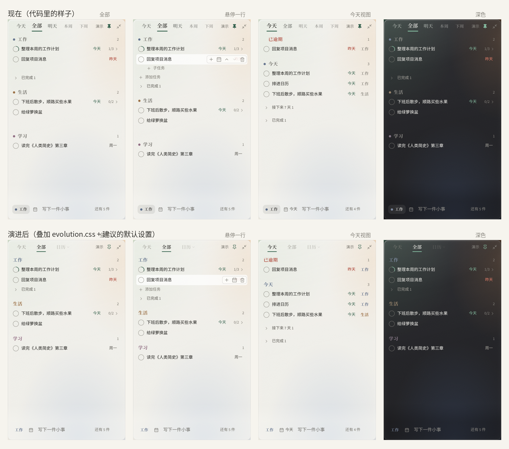
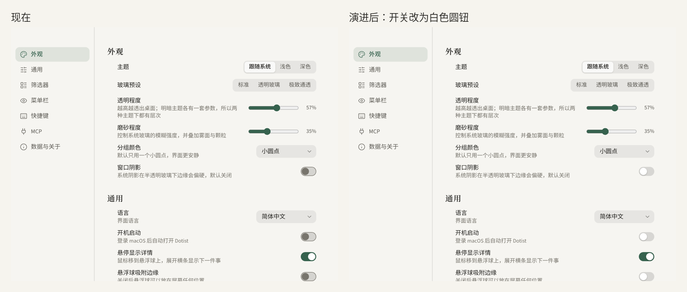

# Dotist

轻、透、少：一扇贴在桌面右上角的待办小窗。

**v3.1（2026-10-30，历史设计快照）**：这一版设计系统按当时 React 客户端的实际代码整理，窗口预览来自当时的 `?demo` 界面。客户端现已退役，四份样式原样保存在 `previews/styles/`（`tokens.css`、`dotist.css`、`app.css`、`views.css`），再叠加 `evolution-v3.1.css`。直接用浏览器打开 `previews/` 中的 HTML 即可查看，无需 Node/npm；这些快照不表示当前 Swift 原生应用的外观。

## v3.1（本轮）：去黄 + 选中不用色块

**1. 去掉黄色。** 代码里 Round 7 把底色、纸色、墨色、边线都调成了偏暖的米黄 / 棕（例如底色 `247, 241, 229`、墨色 `#2b2620`、边线 `rgba(70,52,30,…)`），整页看起来发黄。v3.1 全部换成中性色：

| | 之前 | v3.1 |
|---|---|---|
| 浅色玻璃底 `tint-rgb` | 247, 241, 229（米黄） | 247, 247, 248（中性冷白） |
| 纸 `paper`（设置、视图窗口） | #f6f1e6 | #f5f5f6 |
| 墨 / 次要 / 弱 | #2b2620 / #665e52 / #8a8174（偏棕） | #1c1c1f / #5b5b61 / #76767c |
| 边线、分隔线 | 棕色半透明 | 黑色半透明 |
| 深色玻璃底 | 26, 23, 20（偏棕） | 22, 22, 24（炭黑） |
| 分组色「生活」 | 赭 #8f6a3d（偏黄） | 绛 #8c4a42 |
| 分组色「苔绿」 | #707a3f（橄榄黄） | 石板灰 #5a6672 |

强调色仍是竹青，但略微去黄（#3f6a56）。App 图标、封面、预览里的“桌面”背景也一起换成冷灰。

**2. 选中和悬停不再出现圆角色块。** 统一规则：

- **悬停**：只把文字变深，不铺底色。
- **选中**：文字变深或变成竹青，再加一道 2px 竹青细线。横向排列的控件（视图标签、分段控件、快捷项、看板 / 日历切换）线在下方；纵向排列的列表（设置导航、右键菜单）线在左侧。
- **浮层**：菜单、日历、提示条这类浮层本身可以有底和圆角，但里面的选项没有。

逐项改动：任务行悬停不再铺圆角底，只加深勾选圈；原地编辑改成文字下方一条竹青细线；悬停操作去掉胶囊外框；右键菜单悬停项变成竹青字加左侧细线；日历范围不铺长条，只把数字染成竹青；设置里的下拉框只留底线；输入条聚焦不再出现光晕框；任务视图窗口里，选中的一天改成顶部竹青线加竹青日期，日历 / 看板切换改成带下划线的文字。

这些改动都在 `evolution-v3.1.css` 里，叠加在 `app.css`、`views.css` 之后即可。确认后，建议直接改 `app.css` 里 Round 7 的那组颜色变量，不要再叠一层 `!important`。

## 上一轮（v3）演进

### A. 直接叠加就能生效的（evolution.css，已合并进 app.css Round 8）

| # | 改什么 | 为什么 |
|---|---|---|
| 1 | 头部视图标签统一为衬线 14px，只靠颜色和下划线区分当前项 | 现在当前标签更大，切换时整排会跳动 |
| 2 | 图钉开 / 关都用线性图标，只换颜色 | 全窗只有它一个是实心图标 |
| 3 | 「添加任务」行只在悬停那一组时展开，平时高度为 0 | 现在每组下面都预留了 28px 空白，组间距看起来很松 |
| 4 | 列表里的按钮悬停不放大、按下不缩小 | 密集列表里会显得发抖；弹性动画只留给浮层入场 |
| 5 | 输入条的分组按钮去掉底色块，跟随“分组颜色”设置 | 和组名用同一种表达方式 |
| 6 | 设置开关关闭时用白色圆钮 + 浅灰轨道 | 现在关闭态是深灰圆钮，像是禁用 |
| 7 | 悬停操作只留三个：＋子任务 / 到期日 / 删除；去掉行下方重复的「＋ 子任务」 | 上移下移已经在右键菜单里；现在悬停时会多出一行，整列跳动 |
| 8 | 「已逾期」分段在任何颜色模式下都保持红色 | 彩色名称模式下它会变成黑色 |
| 9 | 按界面语言切换字体：日文用 Noto JP，繁体用 Noto TC；英文去掉中文字距 | 同一个汉字在中日繁里字形不同 |

### B. 需要改默认值或代码的

- **视图标签默认只显示「今天 / 全部 / 日历」**（设置里的 `filters` 默认值）。明天、本周、下周、未来 7 天、已逾期、无日期、已完成这些范围，日历浮层里的快捷项已经都有，标签栏没必要再放一遍。用户仍可在「筛选器」里加回来。
- **分组颜色默认改为「彩色名称」**（`group_colors: 'text'`）。组名本身着色，不再加小圆点；「小圆点」和「不显示」保留为选项。
- **排序**：悬停不再显示 ↑ ↓，改用右键菜单（已有）和 ⌥↑ / ⌥↓ 快捷键；以后可以考虑做拖动排序。
- **今天视图**：「今天」分段里的任务不再重复显示“今天”两个字；行尾只留分组名（分组色、12px）。
- **快速添加**：窗口从 560 × 200 收到 560 × 112，输入框一行，分组 / 到期日 / 提示一行，不留上下空白。
- **多语言字体**：给第 9 条补上 `@fontsource/noto-sans-jp`、`noto-serif-jp`、`noto-sans-tc`、`noto-serif-tc`（只需 400 / 500 / 600）。
- **样式治理**：`app.css` 已经有 56KB，里面有多轮 “Round N” 补丁和 `:root:root:root` 这样叠高优先级的写法。建议用 `@layer tokens, base, components, overrides` 分层，把补丁合并回对应组件，颜色和玻璃参数只从 `tokens.css` 来（这一版的 `tokens.json` 已经收录了实际取值）。

## 现在的产品结构

| 界面 | 主要类名 | 说明 |
|---|---|---|
| 主窗口 | `.dt-window` `.dt-head` `.dt-tabs` `.dt-scroll` `.dt-composer` | 364 × 620，透明毛玻璃，圆角 16 |
| 视图 | `.dt-tab` `.dt-tab-more` | 今天 / 全部 / 日历（可在设置里增减） |
| 分组与任务 | `.dt-group-label` `.dt-row` `.dt-check` `.dt-due` `.dt-subcount` `.dt-sub` | 一级子任务；到期日在行尾 |
| 浮层 | `.dt-menu` `.dt-cal-pop` `.dt-due-pop` `.dt-day-pop` `.dt-toast` | 右键菜单、日历、到期日、撤销提示 |
| 分组管理 | `.dt-manage` `.dt-group-row` `.dt-swatch` | 在窗口里替换列表，不开新窗口 |
| 悬浮球 | `.dt-bubble` `.dt-bubble-core` `.dt-bubble-text` | 48px；悬停展开为横条 |
| 快速添加 | `.dt-quick` `.dt-quick-input` `.dt-quick-meta` | 全局快捷键唤起 |
| 任务视图 | `.dv-window` `.dv-segments` `.dv-day` `.dv-card` | 独立窗口：日历 / 看板 |
| 设置 | `.dt-settings-window` `.dt-set-nav` `.dt-set-row` `.dt-segment` `.dt-slider` `.dt-switch` `.dt-select` | 独立窗口，不透明的 `paper` 底 |

## 原则（不变）

1. **一层到底**：编辑在原行、管理分组在原窗、删除给撤销。新增的浮层（菜单、日历）都是“临时出现、点外面就关”。
2. **透明是底色**：窗口是系统毛玻璃 + 一层可调的底色。文字永远是实色，透明度越高，次要文字自动加深一级（见「玻璃」）。
3. **每个像素都给任务**：悬停才出现的东西不预留空间；同一个操作只放一个入口。
4. **选中不铺色块**：悬停只变色；选中 = 变色 + 2px 竹青细线（横向在下、纵向在左）。
5. **衬线只做名字**：视图标签、组名、设置分区标题用衬线；任务、按钮、数字全部无衬线。

## 玻璃

- **三个变量**：用户能调的是 `--tint-alpha`（底色不透明度，0.04–0.95）和 `--frost`（雾面）。代码据此算出 `--lg`（可读性补偿，0–1）。
- **三档预设**：标准 `0.60 / 0.40`（默认）、透明玻璃 `0.38 / 0.22`、极致通透 `0.08 / 0.04`。
- **自动补偿**：`--lg` 超过 0.45，次要文字加深一级（`data-lg=mid`）；超过 0.7 再加深一级（`high`）。底色低于 0.35 时开启玻璃边缘高光（`data-glass=clear`）。
- **固定的边**：`edge` 是 0.5px 内描边，`highlight` 是顶边 0.5px 高光，深浅色各一套。

## 颜色

- **中性底色**：底、纸、墨、线全部中性，不用米色、奶油色、棕色。
- **强调色**：只有一个 `accent`（竹青 #3f6a56），用在当前视图、勾选、焦点、今天到期、主按钮。
- **分组色六个**：`cat-work` 黛、`cat-life` 绛、`cat-study` 檀、`cat-teal` 青碧、`cat-rose` 胭脂、`cat-moss` 石板灰。深色模式用低饱和的“雾色”，和磨砂玻璃更协调。
- **分组色三种显示方式**：彩色名称（建议默认）/ 小圆点 / 不显示。菜单里的「移到某组」、分组管理里的色块是唯一允许出现色点的地方。
- **到期日**：今天 `accent`；已逾期 `danger`；未来 7 天 `ink-muted`；更远 `ink-faint`。

## 字体

| 角色 | 中文 | 英文 | 日文 / 繁体 |
|---|---|---|---|
| 衬线（视图标签、组名、设置标题） | 思源宋体 600 | Source Serif 4 600 | Noto Serif JP / TC |
| 无衬线（任务、按钮、数字、说明） | 思源黑体 400 / 500 | Source Sans 3 | Noto Sans JP / TC |

字体栈一律“英文在前、同类 CJK 在后”，中英混排时各自落到对应的字体上。英文界面里，标签、按钮、设置项都要按英文长度留宽度，放不下就省略号截断，不换行。

## 动效

- **两条缓动**：`ease-smooth` 用于几乎一切；`ease-spring`（带一点回弹）只用于浮层入场（菜单、日历、到期日、快速添加）和开关的圆钮。
- **列表里不做弹跳**：列表里的按钮、行、文字悬停都不缩放。
- **时长**：窗口 ↔ 悬浮球 220 / 260ms；展开收起 140ms。
- **减少动态效果**：系统开启时只保留 120ms 淡入淡出。

## 图标

用 lucide-react，统一 16px、线宽 1.5，放在 24px 的点击区里；删除图标 15px（光学校正）。开 / 关两种状态只换颜色，不换成实心。

## Logo、菜单栏、悬浮球

Logo 是「。.」：空心圈是中文句号，实心点是英文句号。App 图标、菜单栏模板图标、悬浮球都从这个图形来，文件在 `logo/`。当前原生图标由 `../native/scripts/generate-icons.py` 生成到 `../native/Assets/`。

## 本文件夹

- `evolution-v3.1.css`：本轮补丁（去黄 + 选中不用色块）。静态预览在 `previews/styles/app.css` 之后引入；保留当时的颜色与 hover 设计对照。
- `evolution.css`：上一轮（v3）补丁，已基本合并进 `app.css` 的 Round 8，留作对照。
- `tokens.json` / `tokens.css`：v3.1 的中性色与其余设计变量。
- `previews/`：引用 `previews/styles/` 保存的客户端样式 + 本轮补丁渲染的历史界面，用浏览器打开即可。
- `mockups/`：现在 vs v3.1、上一轮 v3 的对比图。
- `logo/`：中性色版的标志、App 图标、菜单栏模板图标（当前生成脚本见 `../native/scripts/generate-icons.py`）。
- `_archive-v1/`、`_archive-v2/`：更早的方向稿与规范。
