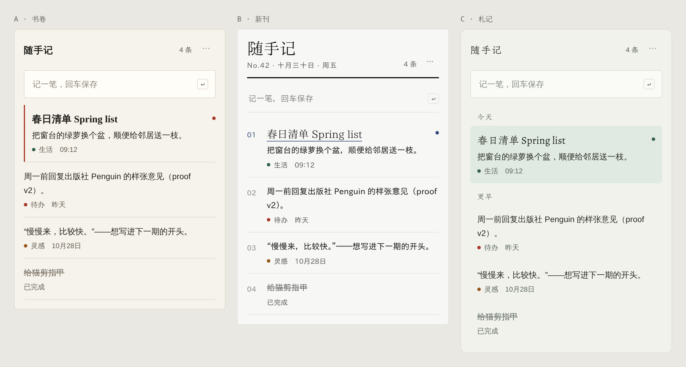

# Dotist

像一张便签那样轻的人文设计系统。

Dotist 是便签级的小工具：打开、记一笔、关掉。这里给出三版彼此独立的方向，**不参考当前界面**。三版用同一套语义色名，页面上方的主题切换就是方向切换（每版各有昼、夜）。组件实现仍沿用 uiarc，本系统只定义视觉语言。

## 共同原则

1. **两层就够。** 只有 `bg`（窗口）和 `surface`（输入框、展开编辑中的便签）。不叠卡片、不开二级页面，编辑在原处展开。
2. **扁平，不拟物。** 不用纸纹、阴影、卷角、纹理；层次只靠 `rule` 发丝线和字号。
3. **一种强调色。** 每版一个 `accent`，只给主按钮、焦点、置顶三件事。
4. **色在点上。** 分类色只出现在 6px 圆点上（`tint-zhu / zhe / qing / dai`），文字永远是墨色。

## 字体规则：衬线做标题，无衬线做正文

全衬线在小字号下可读性差，所以三版都是**衬线 + 无衬线**搭配，并且同一角色里**中英文必须同类**：英文用衬线，中文也必须是衬线；英文用无衬线，中文也必须是无衬线。

| 角色 | 用在哪 | 类别 | 书卷 | 新刊 | 札记 |
|---|---|---|---|---|---|
| 标题 | 刊头、便签标题、分组名 | 衬线 | 中：思源宋体 SemiBold 英：EB Garamond SemiBold | 中：霞鹜新致宋 英：Newsreader | 中：朱雀仿宋 英：Spectral |
| 正文 / 界面 | 便签正文、输入框、按钮、标签 | 无衬线 | 中：思源黑体 英：Source Sans 3 | 中：霞鹜新晰黑 英：IBM Plex Sans | 中：思源黑体 英：Instrument Sans |
| 数字 / 时间 | 时间、计数、序号 | 无衬线（等宽数字） | 同正文 | 同正文 | 同正文 |
| 快捷键 | `↵` 等 | 等宽 | JetBrains Mono | 同左 | 同左 |

**落地写法**：每个字体栈都是「英文字体在前，同类中文字体在后」，例如 `--font-shujuan-serif: "EB Garamond", "Noto Serif SC", serif`。英文字体没有汉字，浏览器会自动把汉字交给后面的中文字体，所以中英混排时各自落到对应的字体上。

**注意**：英文字体排在前面时，弯引号 “” 和 ‘’ 也会用英文字体，字形偏窄，所以中文语境统一用直角引号「」『』。数字一律走正文无衬线，开 `tabular-nums`。

**为什么这样配**：

- 书卷：思源宋体和思源黑体是同一套字体家族，骨架一致；EB Garamond 和 Source Sans 都偏古典人文风格。
- 新刊：霞鹜新致宋和霞鹜新晰黑出自同一作者，笔画气质成对；IBM Plex Sans 的硬朗正好平衡 Newsreader 的报刊感。
- 札记：仿宋笔画细、文气重，只用于标题；正文交给思源黑体，可读性有保障。

**授权**：思源宋体 / 思源黑体 / 朱雀仿宋 / 全部英文字体为 SIL OFL 1.1；霞鹜新致宋 / 霞鹜新晰黑为 IPA 开源许可。`fonts/` 里的三个文件是 GB2312 一级常用字（3,886 字）的子集，用于预览；许可文本、来源及原始字体替换方法见 [fonts/README.md](fonts/README.md)。

## 三版一览

| | A · 书卷 | B · 新刊 | C · 札记 |
|---|---|---|---|
| 气质 | 古典书页，稳重 | 现代报刊，利落 | 随笔札记，松弛 |
| 强调色 | 朱砂 `#a8382a` | 黛蓝 `#2f4a7a` | 竹青 `#35614d` |
| 结构 | 发丝线分行，选中用朱砂竖线 | 粗线刊头 + 序号列，直角 | 按日期分组，无分隔，选中用浅底 |
| 圆角 | `radius-shujuan` 2px | `radius-xinkan` 0 | `radius-zhaji` 6px |

## 建议

- 想要**最稳、最耐看**：A · 书卷。思源宋体和思源黑体同属一个家族，混排最协调，字重也最全。
- 想要**辨识度**：B · 新刊。刊头和序号让便签像一份私人小报，和“Dot”的点状节奏也很搭。
- 想要**最轻松**：C · 札记。朱雀仿宋的标题文气最重，但它还是技术预览版，字形会继续调整。

## 视觉基础

- **颜色**：13 个语义色 × 6 个主题。`ink` 对 `surface` ≥14:1，`ink-muted` ≥5.5:1，`ink-faint` 约 3.4:1，只给占位符和序号用。
- **字号**：标题 17–28px（衬线），正文 14px / 24px（无衬线），元信息 12px。
- **间距**：4 的倍数，`space-1` 到 `space-8`；窗口左右统一 `space-4`。
- **图标**：1.5px 线性、16px 网格；能用字就不用图标，不用表情符号。

## 文案语气

短、具体，像朋友留的字条。按钮用动词（保存、完成）；空状态写「还没有便签，记下第一件小事吧」。

## 落地到 uiarc

把 uiarc 主题层的背景、前景、边框、主色变量分别指向 `--bg`、`--ink`、`--rule`、`--accent`；把它的标题字体指向 `--dt-serif`，正文字体指向 `--dt-sans`（见 `components/bundle.css`）。组件结构不用改。
