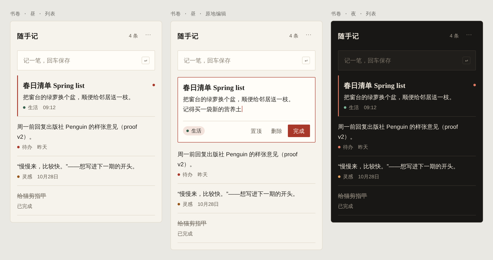

# A · 书卷

**古典书页：思源宋体做标题，思源黑体做正文，朱砂点睛。**

- **字体**：标题用思源宋体 SemiBold，其中英文用 EB Garamond SemiBold；正文和界面用思源黑体，其中英文用 Source Sans 3。两套都来自思源家族，混排时字面大小和重心一致。
- **色彩**：暖米白 `bg #f6f3ec`，`accent` 朱砂只用在主按钮、焦点和置顶点三处。夜间底色 `#181715`，朱砂提亮为 `#e07a64`。
- **结构**：便签之间用 `rule` 发丝线分隔，选中时左侧出现 2px 朱砂竖线，编辑时朱砂描边、原地展开。圆角 2px。
- **适合**：想要长期耐看、中英混排多的场景。
