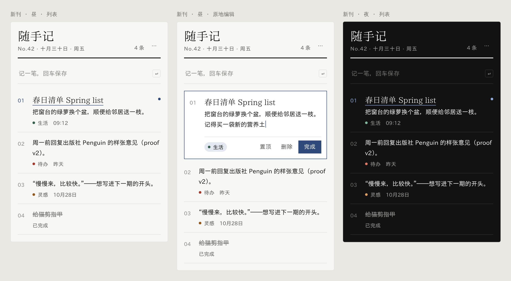

# B · 新刊

**现代报刊：霞鹜新致宋做刊头，霞鹜新晰黑做正文，黛蓝点睛。**

- **字体**：刊头和标题用霞鹜新致宋，其中英文用 Newsreader；正文和界面用霞鹜新晰黑，其中英文用 IBM Plex Sans。新致宋只有一个字重，所以标题的层次全靠字号（刊头 28px、标题 18px）。
- **色彩**：中性冷白 `bg #f7f7f5`，近黑墨色，黛蓝 `accent #2f4a7a`。夜间底色 `#121213`，黛蓝提亮为 `#8fa9d8`。
- **结构**：刊头下压一条 2px 墨线，下面一行写期号和日期；速记框只有一条底线；每条便签左侧带序号，选中时序号变黛蓝、标题加细下划线。全部直角。
- **适合**：想要辨识度，让便签读起来像一份私人小报。
