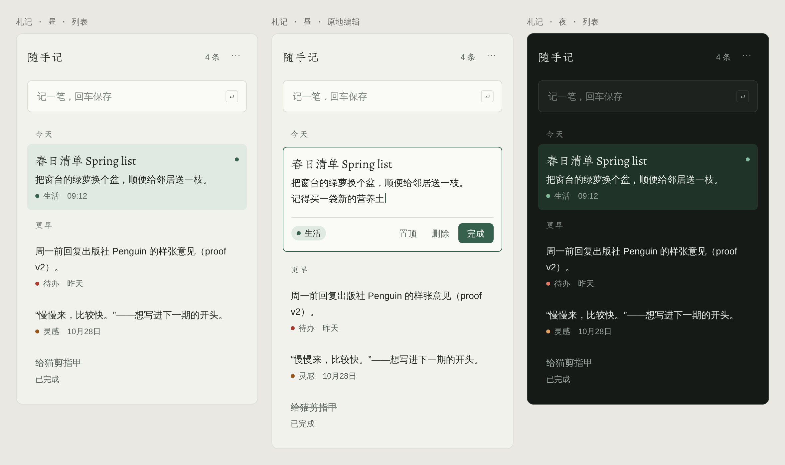

# C · 札记

**随笔札记：朱雀仿宋做标题，思源黑体做正文，竹青点睛。**

- **字体**：标题和分组名用朱雀仿宋，其中英文用 Spectral；正文和界面用思源黑体，其中英文用 Instrument Sans。仿宋笔画细，只用在 17px 以上的标题。
- **色彩**：淡青灰 `bg #f1f2ec`，竹青 `accent #35614d`。夜间底色 `#161a17`，竹青提亮为 `#7fb89b`。
- **结构**：便签按「今天 / 更早」分组，行与行之间不画线；选中时铺一层 `accent-soft` 浅底，用 6px 圆角。
- **注意**：朱雀仿宋目前还是技术预览版（0.108），字形可能还会调整。
