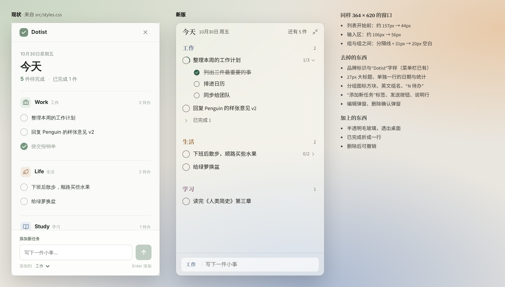
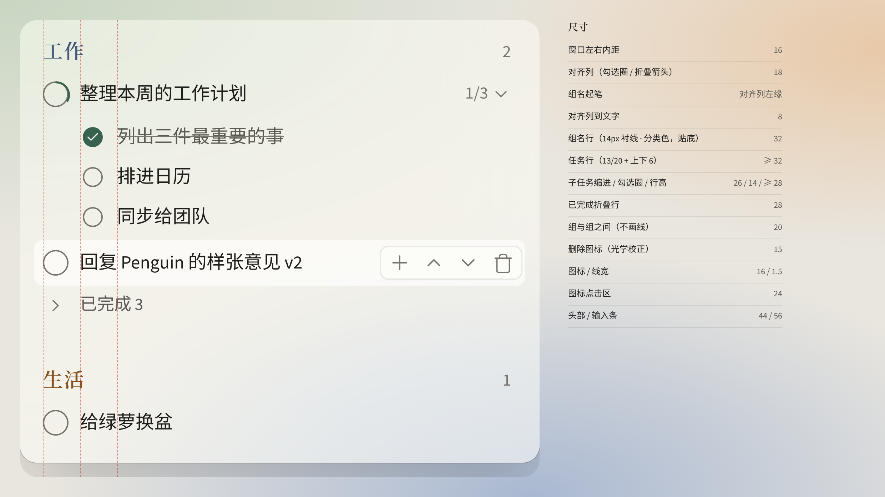
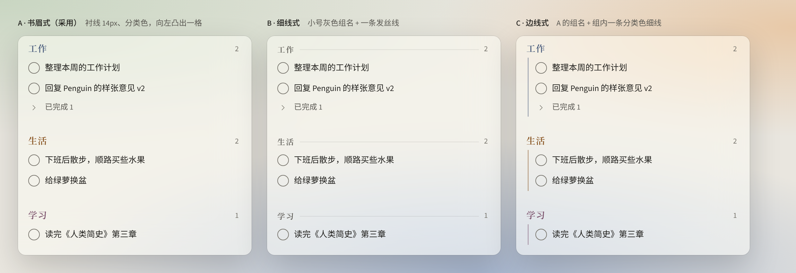
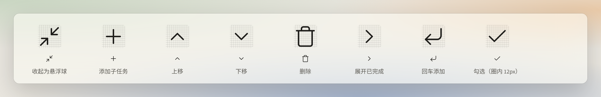
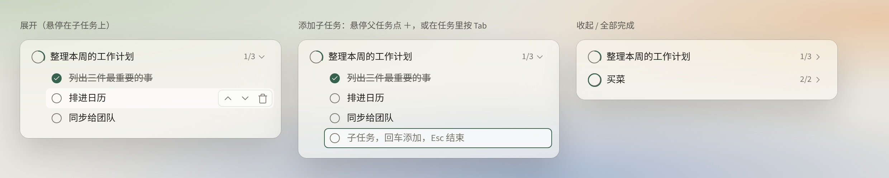
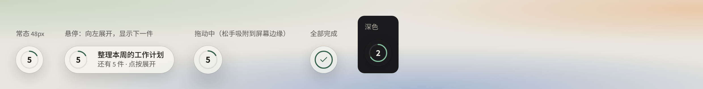
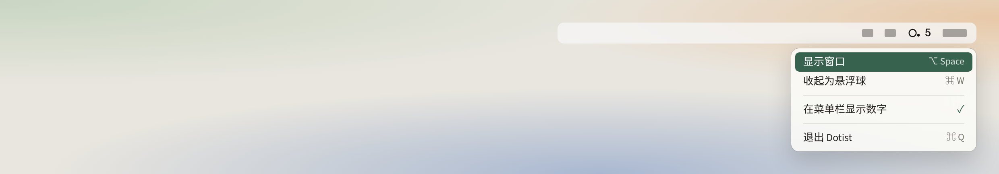
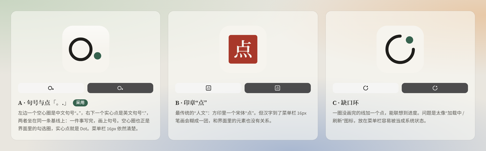

# Dotist


轻、透、少：一扇贴在桌面右上角的待办小窗。

这套设计系统是照着 Dotist 现在的代码写的（Tauri 2 + React，364 × 620 无边框置顶窗，分工作、生活、学习三组）。它只定义视觉语言和交互约定，**还没有改动项目代码**，落地方法见文末。



## 三条原则

1. **每个像素都给任务。** 窗口里只留四样东西：一行头部、分组名、任务行、一条输入框。其余的标签、图标方块、说明文字、确认弹窗都删掉。
2. **透明是底色。** 窗口本身用 macOS 原生毛玻璃，上面只叠一层很薄的 `material-tint`。凡是“抬起来”的东西（输入框、悬停行、提示条）也是半透明的 `surface`，不用实色卡片。
3. **一层到底。** 不开新页面，不弹模态框。编辑在原行展开，删除给撤销，分类在输入框里点一下就能切换。

## 窗口结构（364 × 620）

| 区域 | 高度 | 内容 | 现状对照 |
|---|---|---|---|
| 头部 `dt-head` | `header` 44px | 「今天」（衬线 16px）· 日期 · 还有 N 件 · 收起为悬浮球。整行可拖动 | 顶栏 47px + 介绍区约 110px |
| 分组名 `dt-group-label` | `group-label` 32px | 组名（衬线 14px、分类色，向左凸出一格）· 待办数（靠右）。没有色点 | 26px 图标方块 + 英文 + 中文 + “N 待办” |
| 任务行 `dt-row` | `row` 32px 起 | 18px 勾选圈 · 13/20 文字；悬停时右侧出现 上移 / 下移 / 删除 | 35px，4 个操作 |
| 已完成 `dt-folded` | 28px | 「› 已完成 N」，默认收起 | 和待办混在一起 |
| 组与组之间 | `space-5` 20px | 只留空白，不画线 | 分隔线 + 31px 内距 |
| 输入条 `dt-composer` | `composer` 56px | 分类（点击轮换）· 细竖线 · 输入框；有字时右侧出现回车图标 | 标签 + 输入 + 发送按钮 + 说明行，约 106px |

### 一条对齐线



左侧留一条 18px 的**对齐列**（`column`）：勾选圈和折叠箭头居中在这一列里。任务文字、「已完成 N」、出错提示都从「对齐列 + 8px」开始；**组名则从对齐列的左边缘起笔**，比任务文字往左凸出一格。再加上组名比任务大一号（14px 对 13px）、用衬线和分类色，三重区别让“组”一眼就是上一级，不需要色点或图标来提示。右侧所有可点的图标统一放在 24px（`hit`）的点击区里，右边缘也对齐。



组名试过三种写法：A 书眉式（采用）、B 细线式、C 边线式。B 更安静但组名太弱；C 包裹感最强，但多了三条彩色线。如果你更喜欢 B 或 C，只需给列表容器加一个类名（`is-rule` / `is-bar`）就能切换。

整窗只有一条横线：输入条上方的 `rule`。分组之间只靠空白区分。

## 透明与层次

| token | 浅色 | 深色 | 用在 |
|---|---|---|---|
| `material-tint` | 白 58% | 黑 52% | 窗口底，叠在系统毛玻璃上 |
| `surface` | 白 62% | 白 7% | 输入框、悬停行、编辑中的行 |
| `surface-float` | 白 86% + `blur-float` | 灰 86% | 撤销提示条 |
| `rule` | 墨 9% | 白 9% | 唯一的分隔线 |

文字不用透明色，`ink` 和 `ink-muted` 都是实色。这样桌面背景再花，文字对比度也稳定：正文最差情况下约 12:1，次要文字约 4.9:1。

## 字体：衬线只给“名字”，内容全用无衬线

| 角色 | 用在哪 | 中文 | 英文 |
|---|---|---|---|
| 衬线 `font-serif` | 「今天」、分组名 | 思源宋体 SemiBold | Source Serif 4 SemiBold |
| 无衬线 `font-sans` | 任务文字、输入框、日期、计数、按钮 | 思源黑体 | Source Sans 3 |

- 同一个位置里中英文必须同类：英文用衬线，中文也一定是衬线。字体栈都是「英文在前、同类中文在后」，例如 `"Source Serif 4", "Noto Serif SC", serif`，中英混排时会各自落到对应的字体上。
- 四款字体都是 Adobe 思源 / Source 家族，开源（SIL OFL），骨架一致，混排最协调。
- 任务文字从 12px 提到 13px，可读性更好，靠压缩空白把这 1px 赚回来。
- 中文里统一用「」，不用弯引号（英文字体在前时，弯引号会显得偏窄）。

## 颜色

- 强调色只有一个：`accent` 竹青，只用在已勾选的圈、焦点环、输入框聚焦描边、撤销按钮。
- 分类色 `cat-work`（黛）、`cat-life`（赭）、`cat-study`（檀）只用在两个地方：组名，以及输入框 / 编辑行里的分类按钮。任务文字永远是墨色。
- `danger` 只在删除图标悬停和出错文字上出现，不做红色按钮。

## 交互约定（替代掉的元素）

- **编辑**：点任务文字，在原行变成输入框，右侧的分类按钮（分类色的字）点一下切到下一类；回车保存，Esc 取消。替代 `EditDialog`。
- **删除**：点垃圾桶直接删除，底部出现 5 秒的「已删除「…」 撤销」。替代删除确认弹窗。
- **新增**：输入框左侧显示当前分类，点一下轮换 工作 → 生活 → 学习；回车添加，输入法组字时不提交（保留现有逻辑）。不再需要发送按钮和说明行。
- **已完成**：从列表中移到组底「› 已完成 N」，点开再看。
- **空组**：整个分组隐藏。三组都空时，只显示一句「把要做的事，放在这里。」
- **出错**：头部下面一行 `danger` 小字，不加底色块。
- **演示数据**：在日期后面加一个 `ink-faint` 的「演示」两个字，不用色块标签。

## 图标

沿用项目已有的 lucide-react，全窗只用 8 个：收起、添加子任务、↑ ↓、删除、›、回车、✓。

- 统一 16px、线宽 1.5、圆头圆角，放在 24px 的点击区里；默认颜色 `ink-faint`，悬停变 `ink` 并铺 `surface` 底。
- 光学校正：垃圾桶外形饱满，缩到 15px，才和 16px 的箭头看起来一样大。
- 勾选圈里的 ✓ 用 12px、线宽 2，在 18px 的圆里居中。
- 回车图标平时隐藏，输入框里有字时才出现，并变成 `accent` 色。
- 写法：`<Trash2 size={15} strokeWidth={1.5} />`、`<ChevronUp size={16} strokeWidth={1.5} />`。现有代码里 13–18px、线宽 2–3 混用，是图标看起来不统一的主要原因。



## 子任务



只做一级，不允许子任务再套子任务。

- **缩进**：每往下一级缩进 26px（`indent`），子任务的勾选圈正好落在父任务文字的起笔线上。组、任务、子任务三条起笔线各差一格。
- **大小**：子任务勾选圈 14px，比父任务的 18px 小一号；行高至少 28px。文字大小和任务一样（13px），保证好读。
- **进度**：父任务的勾选圈上画一圈竹青色进度弧。右侧的「1/3」同时是展开 / 收起开关。
- **添加**：悬停父任务点 ＋，或者编辑任务时按 Tab；在子任务里按 Shift+Tab 退回一级。
- **完成规则**：勾选父任务等于把所有子任务一起完成；子任务全部完成时，父任务不自动完成，进度弧画满，等用户自己确认。
- **悬停操作**：改成浮在行尾的小胶囊，不再占用文字宽度，长任务不会因此提前换行。
- **数据**：现有表结构没有父子关系，需要在 Rust 核心里加 `parent_id`，MCP 工具也要相应支持。

## 悬浮球与展开收起



- **悬浮球**：窗口收起后变成一个 48px（`bubble`）的毛玻璃圆，中间是剩余件数，外圈是今天的完成进度。悬停时向内侧展开成胶囊，显示下一件要做的事；拖动时略微放大，松手吸附到屏幕边缘；全部完成时变成一个 ✓。
- **触发**：头部右上角原来的 × 改成「收起为悬浮球」。完全隐藏交给菜单栏，不再占用窗口里的位置。
- **动效**：收起 220ms（`dur-collapse`）：内容先淡出，再向悬浮球所在的角收缩、圆角变成正圆。展开 260ms（`dur-expand`）：倒过来播放。统一用 `ease-out`，不回弹。子任务和已完成的展开收起 140ms（`dur-fold`）。开启“减少动态效果”时只做 120ms 淡入淡出。
- **实现提示**：窗口本身是透明的，动画在网页里做；动画结束后再用 Tauri 把窗口尺寸改成 48×48 并贴到边缘，这样透明区域不会挡住鼠标点击。

## 菜单栏



- 用纯黑模板图标（`icon_as_template(true)`），macOS 会自动处理深浅色和高亮。右侧可以显示剩余件数（Tauri 的 `set_title`），在菜单里开关。
- 左键点击：显示或收起窗口。右键菜单只有四项：显示窗口、收起为悬浮球、在菜单栏显示数字、退出。

## Logo



**风格：扁平、单线、两个句号。** 左边一个空心圈是中文句号「。」，右下一个实心点是英文句号「.」，两者坐在同一条基线上：一件事写完，画上句号。这个空心圈也就是界面里的勾选圈，实心点就是 Dot，所以 Logo、菜单栏图标、悬浮球、进度弧都来自同一个图形。

- **App 图标**：纸色底、墨色圈、竹青点；深色版底色和圈的颜色反过来。没有立体效果，只在顶部加一层很淡的高光。
- **菜单栏**：纯黑单色，22pt 画布，图形约 16pt。
- **另外两个方向**：印章「点」更传统，但汉字在 16px 下会糊；缺口环太像加载 / 刷新图标。
- **文件**：`logo/` 里有 SVG 和 PNG（1024 App 图标、菜单栏 1x/2x）。项目里 `src-tauri/icons/` 的现有图标还没有替换。

## 落地（先不改代码，改的时候按这里来）

**1. 窗口透明**（`src-tauri/tauri.conf.json`）

```json
"app": {
  "macOSPrivateApi": true,
  "windows": [{ "label": "main", "transparent": true,
    "windowEffects": { "effects": ["popover"], "state": "active", "radius": 12 }, "...": "其余保持不变" }]
}
```

`src-tauri/Cargo.toml` 里给 tauri 加上 `"macos-private-api"` feature。CSS 里让 `html`、`body` 的背景透明，`.app-shell` 用 `var(--material-tint)`。`state: "active"` 让窗口失焦时也保持通透，适合常驻置顶的小窗。注意：`macOSPrivateApi` 不能上架 App Store，目前本地构建没有影响。

**2. 字体离线打包**：现有 CSP 是 `default-src 'self'`，所以不能用 Google Fonts。用 npm 安装 `@fontsource/source-serif-4`、`@fontsource/source-sans-3`、`@fontsource/noto-serif-sc`（只要 600）、`@fontsource/noto-sans-sc`（400 / 500），在 `main.tsx` 里引入即可。它们按 unicode-range 切片，只会加载用到的字。

**3. 样式**：`tokens.css`（由 `tokens.json` 生成）加上 `dotist.css`，就是可以直接对照的完整样式。类名和现有代码的对应关系：

| 现有类名 | 新版 |
|---|---|
| `.top-bar` + `.intro` | `.dt-head` |
| `.group-heading`（含 `.group-icon`、`h2 span`、`.group-count`） | `.dt-group-label` |
| `.task-row` / `.check` / `.task-title` / `.small-action` | `.dt-row` / `.dt-check` / `.dt-text` / `.dt-icon` |
| `.composer`（含 `.composer-label`、`.send-button`、`.composer-meta`） | `.dt-composer` → `.dt-field` |
| `.error-banner` | `.dt-error` |
| `.overlay` + `.dialog` | 删除，改为原地编辑和 `.dt-toast` |

## 本文件夹

- `tokens.json` 设计变量源文件，`tokens.css` 由它生成
- `dotist.css` 组件样式（类名 `dt-*`）
- `logo/` 标志、App 图标、菜单栏模板图标
- `mockups/` 示意图，`previews/` 可在浏览器直接打开（Motion 是循环动画）
- `_archive-v1/` 上一轮的三版方向，留作参考
