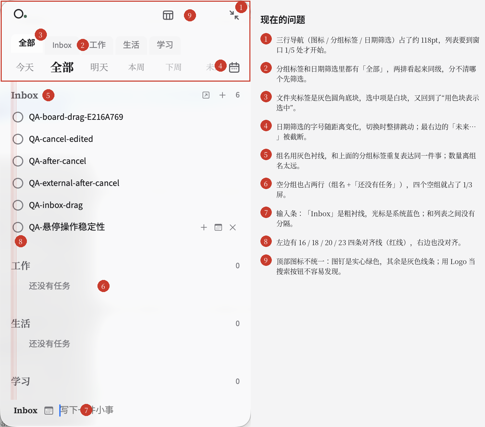
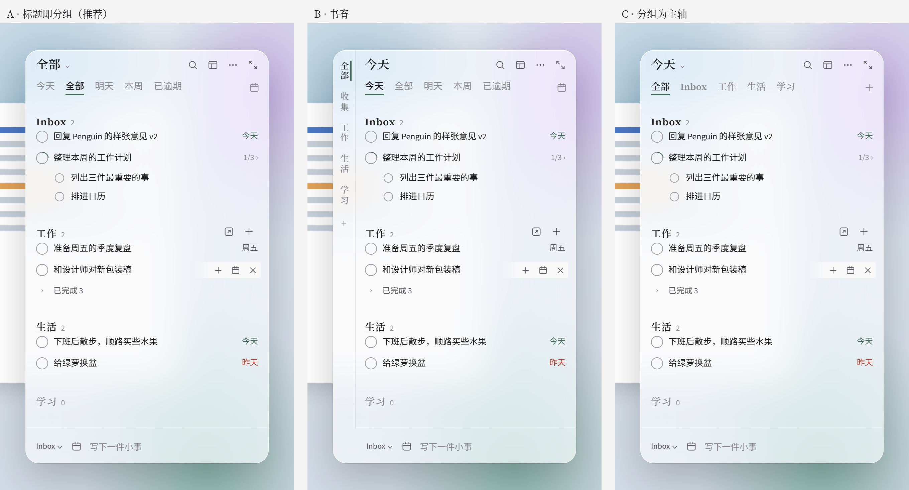
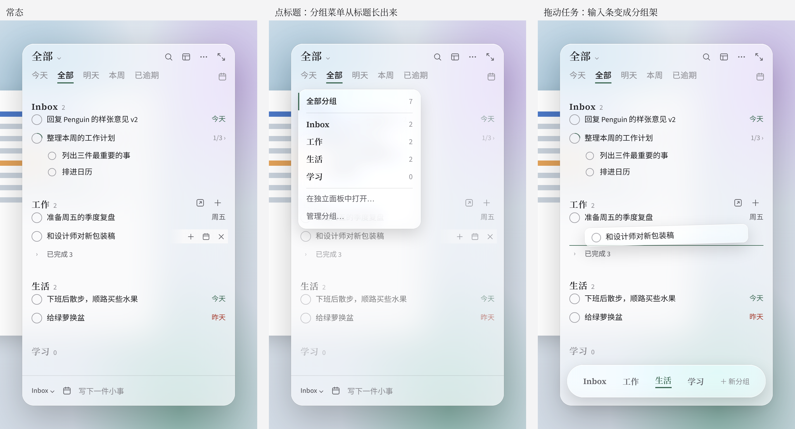
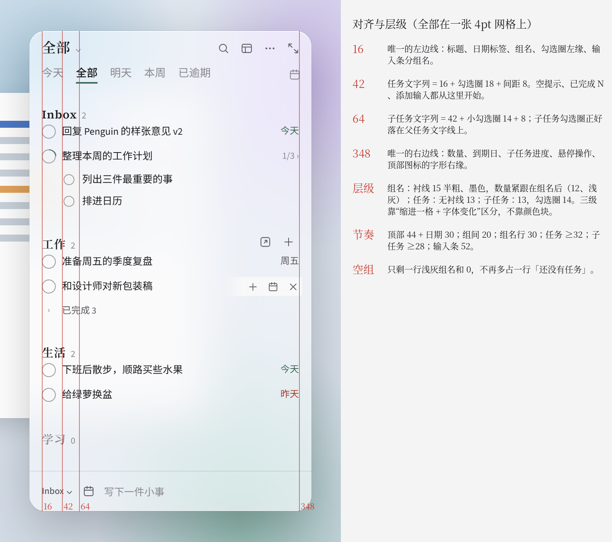
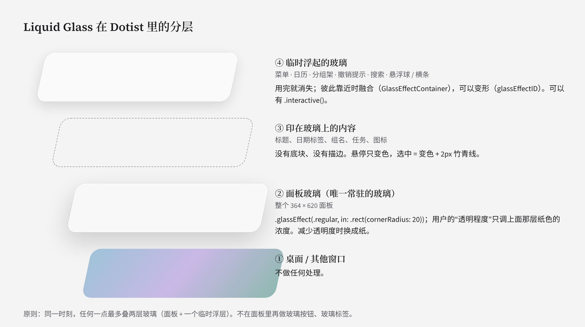
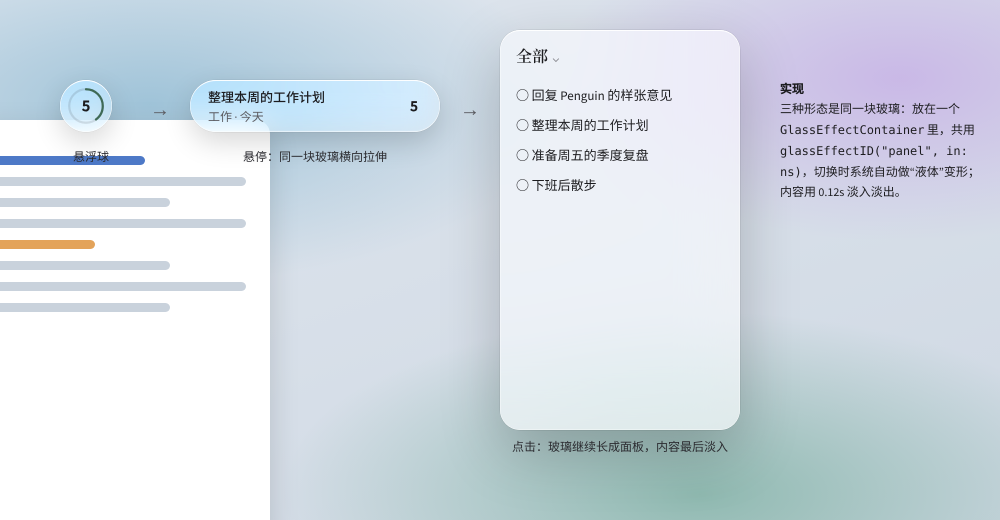

> ⚠️ 已被 `../v4/SPEC.md` 取代。本目录图中的下划线选中、菜单左竖线、进度环等已被禁用，仅作探索记录。

# Dotist 设计系统 · v4 探索（2026-11-01）：原生 SwiftUI + Liquid Glass

> 前端已经换成 SwiftUI + AppKit（macOS 26），样式由 `native/Sources/DotistApp/Design/DotistDesign.swift` 决定。下面 v3.x 的网页样式（`dotist.css` / `app.css` / 补丁）只作为历史参考，不再是当前实现。本节是方向探索，还没有改代码。

### 1. 现在的问题

1. **导航太厚**：图标行、分组标签、日期筛选三行，约 118pt；如果有标签，还会多一行。列表要到窗口约 1/5 处才开始。
2. **两套标签看起来同级**：分组标签和日期筛选里都有「全部」，分不清哪个先筛选。
3. **分组标签又用了色块**：文件夹标签是灰底圆角块，选中是白块。
4. **日期筛选字号随距离变化**：切换时整排跳动，最右边被截断。
5. **组名说了两遍**：列表里的组标题和上面的分组标签表达的是同一件事。组名是灰色，数量离组名太远。
6. **空分组浪费空间**：每个空组占两行，四个空组就占了 1/3 屏。
7. **输入条**：「Inbox」是粗衬线，光标是系统蓝色（没有设 `.tint`），和列表之间没有分隔。
8. **对齐**：左边有 16 / 18 / 20 / 23 四条线，右边也不齐。
9. **图标两套**：顶部是自绘 Path（线宽 1.55），行内和组标题用的是 SF Symbols。图钉是实心绿色，用 Logo 当搜索按钮也不容易发现。

代码层面还有几处和 Liquid Glass 的用法不一致：

- **面板材质**：面板用 `.glassEffect(.clear.interactive())`，再盖一层纸色。`.clear` 本来是给图片、视频这类背景用的；`interactive` 放在整块面板上，每次点击都会触发玻璃反馈。
- **标签组件**：`DotistGlassTabs` 的选中项是胶囊色块，和“选中不铺色块”的规则冲突。
- **玻璃叠玻璃**：`DotistActionStyle` 在玻璃面板里又放了玻璃胶囊按钮。
- **撤销提示**：用的是 `surface` 色块加 8pt 圆角，没有用玻璃。

### 2. 分组标签放哪：三个方向

| | A · 标题即分组（推荐） | B · 书脊 | C · 分组为主轴 |
|---|---|---|---|
| 做法 | 去掉分组标签行。左上角的大标题就是当前分组（「全部 ⌄」），点开是分组菜单；日期筛选保留一行 | 面板左侧一条 34pt 的竖排书脊，组名竖写；顶部只留日期 | 分组标签保留，但改成和日期一样的文字标签；日期挪进标题菜单（「今天 ⌄」） |
| 顶部高度 | 74pt（现在约 118） | 74pt，但占 34pt 宽度 | 74pt |
| 组名出现几次 | 1 次（列表里的组标题） | 2 次 | 2 次 |
| 优点 | 最省空间；“分组 → 任务”只有一种表达；和独立面板一致（独立面板的标题就是组名） | 最有人文感；所有分组一直可见，可以直接拖上去归类 | 改动最小 |
| 代价 | 换分组要多点一次。不过 ⌘0–9、菜单栏、独立面板已经覆盖了常用场景 | 窄窗口更挤；英文名竖排不好看（Inbox 要写成「收集」）；组多时要滚动 | 仍然是两排同级标签；切换今天 / 本周变慢 |

**推荐 A。** 分组本来就是列表的“章”，组标题已经在列表里，不需要在顶部再放一排目录。分组之所以要放在外面，主要是为了拖动归类，这件事交给 Liquid Glass 来做（见下）。

### 3. 方案 A 的交互

- **常态**：第一行是「全部 ⌄」标题（衬线 18），右侧是搜索、任务视图、更多（置顶、固定都收进这里）、收起。第二行是日期：今天、全部、明天、本周、已逾期，字号相同，当前项墨色加 2px 竹青下划线；其他范围放在右侧的日历里。
- **点标题**：直接用原生 `Menu`，macOS 26 自带 Liquid Glass 和键盘操作。菜单项是全部分组、各组（带数量）、在独立面板中打开、管理分组。当前项不用色块，用左侧竹青线标出。
- **拖动任务**：一开始拖，底部输入条就变形成一条“分组架”，上面是各组名和「＋ 新分组」，松手即归类，松手后变回输入条。分组标签原来承担的“拖到这里归类”就这样替代了，而且只在需要时出现。

### 4. 对齐与层级

- **左边线**：只有一条，16。标题、日期标签、组名、勾选圈左缘、输入条都从这里开始。
- **文字列**：任务文字在 42（16 + 勾选圈 18 + 间距 8）；子任务文字在 64，子任务的勾选圈正好落在父任务文字线上。
- **右边线**：只有一条，348。数量、到期日、子任务进度、悬停操作、顶部图标都对齐到这里。
- **层级**：组名用衬线 15 半粗、墨色（不用灰色），数量紧跟在组名后面；任务 13；子任务 13，勾选圈 14。三级靠“缩进一格 + 字体变化”区分，不靠颜色块。
- **节奏**：顶部 44 + 日期 30；组间 20；组名行 30；任务 ≥32；子任务 ≥28；输入条 52。
- **空分组**：只剩一行浅灰的组名和 0。

### 5. Liquid Glass 怎么用

1. **只有一块常驻的玻璃，就是面板本身。** 用 `.glassEffect(.regular.tint(paper.opacity(t)), in: .rect(cornerRadius: 20))`：把用户的“透明程度”放进 tint，而不是另盖一层纸，这样玻璃的折射和高光还在。去掉面板上的 `.interactive()`。减少透明度时换成纸。
2. **面板里的东西不再做玻璃。** 标签、按钮、组名、任务行都是“印在玻璃上的字”。去掉 `DotistGlassTabs` 的胶囊选中块和 `DotistActionStyle` 的玻璃胶囊。
3. **用滚动边缘代替分隔线。** 在任务列表的 `ScrollView` 上加 `.scrollEdgeEffectStyle(.soft, for: [.top, .bottom])`，内容滚到标题和输入条下面时自然淡出。
4. **临时浮起来的东西才单独是玻璃**：菜单、日历 popover、分组架、撤销提示、搜索、悬浮球 / 横条。原生 `Menu` 和 `.popover` 在 macOS 26 自带玻璃，不要再自己加背景。
5. **融合与变形**：输入条、分组架、撤销提示放进同一个 `GlassEffectContainer(spacing: 12)`；输入条和分组架共用一个 `glassEffectID`，拖动开始时就是“同一块玻璃变了形”。
6. **悬浮球 → 横条 → 面板也是同一块玻璃。** 共用 `glassEffectID("panel", in: ns)`，内容 0.12s 淡入淡出。`.interactive()` 只给悬浮球（按下时的果冻反馈）。

7. **同心圆角**：面板 20；在面板里距边 8pt 的浮层用 12（`ConcentricRectangle` / `.containerShape`），不要各写各的圆角。
8. **颜色**：玻璃不着竹青，竹青只出现在文字和细线上；用 `.tint(DotistDesign.accent)` 统一光标、开关等系统控件。
9. **图标统一成一套**：建议全部改用 SF Symbols（regular 字重，13–15pt，和系统 Liquid Glass 控件同源），只保留 Logo 为自绘。图钉开关维持现在的“实心竖直 / 空心倾斜”，颜色用墨色而不是绿色。

### 6. 建议的推进顺序

1. **对齐与层级**（第 4 节）：只改间距和字体，风险最小，效果最明显。
2. **面板玻璃改为 `.regular` + tint，并加滚动边缘效果**（第 5 节第 1–3 条）。
3. **顶部收成两行**：标题菜单 + 统一字号的日期标签，去掉分组标签行。
4. **拖动时出现分组架，撤销提示改为玻璃**。
5. **悬浮球 / 横条 / 面板统一 `glassEffectID` 变形**。
